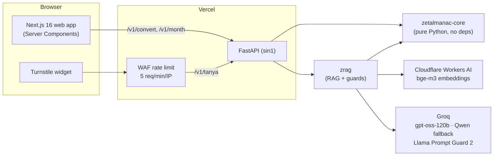

# Zetalmanac

A date converter for five calendar systems, plus a source-grounded AI assistant that answers
questions about calendars. Built as a data science / AI engineering portfolio project, at zero cost,
with every component validated or evaluated against independent data.

**Live:** [zetalmanac.vercel.app](https://zetalmanac.vercel.app) ·
**API:** [zetalmanac-api.vercel.app/v1/health](https://zetalmanac-api.vercel.app/v1/health)

> Technical documents in [`docs/`](docs/) (calendar specs, ADR, threat model, runbook) are written
> in Indonesian. This README summarises them in English.

## What it does

- **Convert** a date between Gregorian, Julian, Hijri (tabular / *hisab urfi*), Chinese
  (astronomical, 1901–2100), and Maya (Long Count, Tzolk'in, Haab', Lords of the Night). Each
  variant is a parameter, not a hidden choice: four Hijri leap-year schemes, civil vs astronomical
  epoch, evening start of the Hijri day, three Maya correlation constants, leap months in the
  Chinese calendar.
- **Show the working:** step-by-step calculations for the Gregorian, Hijri, and Maya conversions.
- **Monthly calendar** with Hijri and Chinese dates side by side, and upcoming notable days.
- **Ask** (`/tanya`): an assistant that answers only from a licensed corpus, cites its sources, and
  computes dates by calling the validated conversion engine instead of letting the LLM do arithmetic.

## Architecture



The conversion API never depends on the AI stack: if every AI provider is down, the converter keeps
working and the assistant degrades to showing the most relevant source excerpts.

**Assistant pipeline** (`rag/zrag/tanya.py`):
input validation → Prompt Guard → dense retrieval (bge-m3, top 5 of 256 chunks) → LLM with numbered
sources and a `konversi_tanggal` tool → citation check → output check (system-prompt canary, HTML,
links) → model fallback chain → excerpt-only fallback.

## Validation of the calendar engine

| Calendar | Independent reference | Size |
|---|---|---|
| Hijri (tabular) | ICU `islamic-civil` / `islamic-tbla` golden file | 54,937 rows (every month start 1–2000 AH, both epochs, every day 1440–1460 AH) |
| Chinese | Hong Kong Observatory tables | 73,048 days and 2,400 major solar terms, 1901–2100 |
| Gregorian / Julian / JDN | Published anchor dates (Reingold & Dershowitz) | anchors + property-based tests (Hypothesis) |
| Maya | Published correlation constants and anchor dates | anchors + unit tests |

Disagreements are not hidden: historical Chinese months where the reference used a different
time zone are listed as documented exceptions, with a test that fails if an exception becomes
stale. A row missing from the HKO English table (30 Dec 2069, present in the Chinese edition) is
documented as a known gap and has been reported to the observatory.

## Evaluation of the assistant

All datasets, raw runs, and reports are in [`eval/`](eval/). Labels were reviewed by hand, and
several "model failures" turned out to be labelling or scoring bugs, which were fixed and recorded.

**Retrieval** (36 queries; 16 are cross-lingual, i.e. the answer exists only in the other language):

| System | Recall@5 | Cross-lingual recall@5 | MRR@10 |
|---|---|---|---|
| BM25 (language-detected) | 0.64 | 0.34 | 0.64 |
| **bge-m3 dense (deployed)** | **0.77** | **0.52** | **0.76** |
| BM25 + bge-m3, RRF | 0.74 | 0.44 | 0.71 |
| Gemini Embedding 2 (offline reference) | 0.87 | 0.74 | 0.92 |

Hybrid search *lowered* recall here: language-detected BM25 returns one language only, and RRF's
agreement bonus pushed cross-lingual hits out of the top 5 (about 95% of hybrid top-5 results were in the
BM25 language). A principled fix (bilingual BM25) did not close the gap, so the site uses dense
retrieval only, without tuning fusion weights on the test set. Gemini is not deployed because its
free-tier terms disallow apps likely used by minors and allow training on submitted content.
With 36 queries, paired sign tests show no difference reaching p < 0.05; numbers indicate direction,
not certainty. Details: [ADR 0001](docs/adr/0001-retrieval-dense-bge-m3.md).

**Answers** (17 questions: date conversions, facts with citation checks, out-of-scope refusals):

| Model | Conversions | Facts | Refusals | Total | Mean LLM time |
|---|---|---|---|---|---|
| **gpt-oss-120b (primary)** | 7/7 | 5/6 | 4/4 | **16/17** | 2.8 s |
| Qwen3.8-27B (fallback) | 5/7 | 5/6 | 4/4 | 14/17 | 6.5 s |

Qwen's two conversion "failures" answered correctly from the sources instead of calling the tool (the dates were in the corpus), which led to adding a test date that exists only via the tool. The remaining fact failure is a retrieval miss. A manual review
([`jawaban-tinjauan.md`](eval/reports/jawaban-tinjauan.md)) found faithfulness problems that pass
automatic checks, e.g. a cited sentence the source does not support.

**Faithfulness per claim** (58 claims, human-labelled, then judged by an LLM from a *different*
model family than the one that wrote the answer):

| Answering model | Claims | Unsupported or overstated | Wrong citation |
|---|---|---|---|
| gpt-oss-120b | 23 | 7 (30%) | 6 |
| Qwen3.8-27B | 35 | 6 (17%) | 2 |

The difference is not significant (Fisher p = 0.34), but it points the opposite way from the
pass-rate ranking, so it is tracked. The LLM judge agreed with the human labels with Cohen's
kappa 0.53 and caught 9 of 13 problematic claims, so it is used to *flag* claims for human review,
not as a final metric. Its one systematic error (lowering the support label when only the citation
was wrong) will be fixed and re-validated on new claims, not on the same 58
([adjudication](eval/reports/faithfulness-tinjauan.md)).

**Security** (17 attacks mapped to the OWASP Top 10 for LLM Applications 2025):

- 17/17 attacks handled, stopped by different layers: input validation 1, Prompt Guard 5,
  prompt rules 9, safe answer 2.
- Prompt Guard alone caught only 5 of 10 injection attempts (explicit "ignore previous instructions"
  in Indonesian and English), with 0 of 51 benign queries blocked. Social engineering, base64
  payloads, and polite requests for the system prompt passed it and were stopped by later layers.
- Controls, decisions, and residual risks: [threat model](docs/security/threat-model.md).

## Key decisions

| Decision | Why |
|---|---|
| LLM never computes dates; it calls the validated engine as a tool | LLMs are unreliable at calendar arithmetic |
| Dense-only retrieval, no hybrid | Measured: hybrid hurt cross-lingual recall (ADR 0001) |
| Groq + Cloudflare, not Gemini, at runtime | Terms of service on minors and data use |
| Defence in depth, not a single guard | Measured: Prompt Guard catches half of injection attempts |
| Vercel WAF + Turnstile instead of a Redis rate limiter | Free tiers cannot bill; provider quotas already cap daily use |
| Answers rendered by a tiny custom renderer | No HTML from the model reaches the page (OWASP LLM05) |

## Known limitations

- Hijri dates are tabular (*hisab urfi*); official dates set by sighting or astronomical criteria
  can differ by 1–2 days. The UI says so.
- Faithfulness is measured on a small human-labelled sample (58 claims, one annotator); the
  automatic judge is a screening tool (kappa 0.53), not a guarantee. Problems concentrate in
  two-part questions and in tool-derived sentences that carry a source citation.
- Evaluation sets are small (36 queries, 17 questions, 17 attacks, 58 claims), so only large
  differences are detectable.
- Wikipedia tables and formulas are lost in plain-text extraction; affected sections are excluded
  from labels and listed in the dataset.

## Stack and cost

Python 3.12 · uv · FastAPI · Next.js 16 · Tailwind CSS v4 · Vercel (Hobby) · Cloudflare Workers AI
and Turnstile · Groq · GitHub Actions (lint, format, tests for core, API, RAG, and web) · Dependabot.
All services run on free tiers: **Rp 0 / month**.

## Repository layout

```
packages/zetalmanac-core/   calendar engine (no dependencies) + golden files
apps/api/                   FastAPI: /v1/convert, /v1/month, /v1/upcoming, /v1/tanya
apps/web/                   Next.js site
rag/                        zrag: corpus checks, chunking, BM25, embeddings, RAG, guards, evals
corpus/                     licensed source texts + manifest (license, revision, sha256)
eval/                       datasets, raw runs, reports
docs/                       specs, ADR, threat model, runbook (Indonesian)
```

## Running locally

```bash
# Calendar engine
cd packages/zetalmanac-core && uv run pytest

# API (http://127.0.0.1:8000/docs)
cd apps/api && uv run fastapi dev app/main.py

# Web (http://localhost:3000)
cd apps/web && npm install && npm run dev

# Assistant evaluations (need keys in .env; see .env.example and docs/operasional/tanya.md)
cd rag && uv run python -m zrag.evaluate
```

## Licences

- Code: [MIT](LICENSE).
- Corpus: Zetalmanac specs CC BY 4.0; Wikipedia extracts CC BY-SA 4.0 with pinned revisions
  ([`corpus/LICENSE-CORPUS.md`](corpus/LICENSE-CORPUS.md)). The assistant shows attribution with
  every answer.
- Search index derived from CC BY-SA sources (`apps/api/data/index/`) is CC BY-SA 4.0.
- Fonts: Latin Modern, under the GUST Font License ([`apps/web/app/fonts/LISENSI.md`](apps/web/app/fonts/LISENSI.md)).

Author: Muhamad Zaky Kurniawan.
